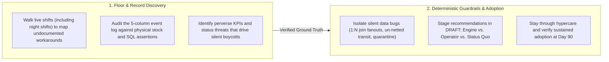

# Marcos Stipicich
### Supply Chain & Operations × Deployment Strategy

Author of *The Deployment Chasm*.

> *"In kind environments, where rules are fixed and feedback is immediate, machines win. In wicked environments—where patterns are messy, rules are unwritten, and human incentives collide—breadth with deep roots wins."*  
> — Adapted from David Epstein (*Range*) and frontline practice.

I operate at the intersection of physical operations, deterministic systems architecture, and unit economics.

---

## Division of Labor: Human Judgment, Deterministic Contracts, and AI Acceleration

Commodity domain knowledge is no longer a moat—a language model can summarize a textbook or draft boilerplate code in seconds. In enterprise deployments, results depend on a strict separation between **what human judgment diagnoses**, **what deterministic code computes**, and **what AI accelerates**:

1. **System-Wide Causal Diagnosis (100% Human-Owned):** Learning to program in `C` before spending 13 years in supply chain and operations wired me to read a business as a single physical memory space: warehouse bins are memory addresses, lead times are bus latency, a stockout is a null pointer, and excess inventory from unaligned sales campaigns is a working-capital memory leak. I walk the floor first to find where broken incentives or cross-silo blindness corrupt the data before any model reads it.
2. **Deterministic Mathematical Boundaries (100% Code-Owned):** In the systems I build, probabilistic models never touch financial arithmetic or write directly to an ERP. Every number is computed by deterministic code, and every writeback is staged in `DRAFT` behind an HMAC-signed approval gate with a verified rollback path.
3. **AI as an Execution Compiler & Adversarial Auditor:** I use AI coding agents as high-speed compilers to draft bilingual specifications, accelerate implementation across Python, TypeScript, and SQL, and run adversarial review subagents (such as `.claude/agents/el-carnicero.md` in Holy Oly) that audit my own diffs against domain invariants before shipping. The floor discovery, the causal thesis, and the accountability for the result remain 100% mine.

---

## From the Sheep Ranch to Enterprise Cutovers

* **Reading Weak Signals in the Field:** Raised on an extensive sheep ranch in Patagonia, where my father's rule was simple: *reading is worth nothing if you can't see it on a working day*. Learning early to read subtle signals—wind shifts, pasture conditions, animal behavior—trained the exact habit I use today when walking a distribution center on the night shift to spot why a new system is being bypassed before the KPI shows it.
* **Respect for the Floor:** Sharing the table and the shearing sheds with frontline workers taught me that the operator on the floor holds practical truths the executive manual ignores. Authority is earned by treating the operator as a peer and designing workflows where the safest rule is also the fastest path on a live shift.
* **Cross-Silo Translation:** Fluent in Spanish and English, translating directly between the three rooms that rarely speak the same language: the warehouse floor, the engineering team, and the CFO.

---

## Operating Methodology: Floor Discovery to Sustained Adoption

Enterprise AI and ERP projects rarely fail in the algorithm; they fail at the boundary between the transaction record and the physical floor.

| Discovery & Deployment Step | Operational Mechanism | Practical Supply Chain & ERP Translation |
| :--- | :--- | :--- |
| **1. Walk the Live Shift** | Observe real constraints before trusting documentation. | Inspect receiving docks, RF scanning habits, and parallel spreadsheets in person. |
| **2. Audit the Incentive** | Separate software bugs from behavior manufactured by KPIs. | Trace mixed, short, and damaged orders back to flawed per-operator volume bonuses; replace with zero-complaint and response-time metrics. |
| **3. Probe Silent Data Corruption** | Verify whether the ERP record lies before feeding it to an agent. | Catch `1:N` PO-schedule join fanouts (`EKPO/EKET`), un-netted in-transit stock, and quarantined dock receipts (`103/105/124`). |
| **4. Protect Operator Authority** | Prevent defensive boycotts by keeping the human in command of the signature. | Present counterfactual cards (*Engine vs. Operator's Play vs. Status Quo*) staged in `DRAFT` rather than imposing black-box overrides. |
| **5. Stay Until Shortcuts Die** | Measure success by what the crew runs after handoff. | Train operators on the floor and stay through hypercare until parallel sheets disappear (`-20%` order processing time after a 50,000+ SKU WMS cutover). |

---

## Field Notes & Published Papers

### 1. [The Smith and the Tailor](https://cdn.jsdelivr.net/gh/esstipi-debug/esstipi-debug@main/papers/the-smith-and-the-tailor.pdf) *(10 pages · PDF)*
**Why many deployments are cut before anyone measures the floor,** what the habit costs once the deployer leaves, and two rules a CEO can set before kickoff.
* **[Read the PDF](https://cdn.jsdelivr.net/gh/esstipi-debug/esstipi-debug@main/papers/the-smith-and-the-tailor.pdf)** · **[View in repository](papers/the-smith-and-the-tailor.pdf)**

### 2. [Nobody Pays for Being Wrong](https://cdn.jsdelivr.net/gh/esstipi-debug/esstipi-debug@main/papers/nobody-pays-for-being-wrong.pdf) *(27 pages · PDF)*
**A bestiary of the go-live:** why obeying the system when it is wrong and dodging it on the night shift answer the exact same incentive rule—and how making someone answer for the decision before the override fixes both.
* **[Read the PDF](https://cdn.jsdelivr.net/gh/esstipi-debug/esstipi-debug@main/papers/nobody-pays-for-being-wrong.pdf)** · **[View in repository](papers/nobody-pays-for-being-wrong.pdf)**

---

## Reproducible Audit Demo: Which Record Lies?

### [Which Record Lies?](demos/which-record-lies) *(Python · 68 automated tests)*
**When a customer says "not received" and the system says "delivered", which record is wrong?** A forensic triage on 95,824 delivered orders from the Brazilian Olist marketplace dataset: **57% of "not received" claims were written on or before the recorded delivery day**, so they were late orders, not suspect customers. The remaining post-delivery conflicts are evaluated per seller against a 99% Poisson quantile threshold.
* **[Code, tests, and README](demos/which-record-lies)** · The dataset is not redistributed; the README lists the files used and their licence (CC BY-NC-SA 4.0).

---

## Core Operational Systems & Prototypes

*(Pre-revenue architecture prototypes built to test deterministic guardrails and adoption mechanics.)*

### 1. [Kern](https://github.com/esstipi-debug/kern) & `nosilo_core` — Deterministic SCM Engine, Level-1 Decision Cockpit & MCP Server
Analytical engine and pre-ERP control plane in Python (**9,966 collected unit tests** at commit `7757fb1`, 60 registered capabilities, and a 39-tool Anthropic MCP server).
* **Anti-Hallucination Boundary:** LLMs interpret unstructured context; deterministic Python owns every financial and inventory calculation.
* **Counterfactual Decision Cards (`src/decision_paths.py`):** Each decision card ranks the engine's paths alongside two more—**The Operator's Play (`operator:`)**, measured with the same engine and objectives, and **Do Nothing (`status_quo:`)**—scored on objectives such as working capital tied up, excess days of inventory, and margin at risk. A cost that could not be measured is never shown as zero.
* **Level-1 Decision Cockpit (`webapp/cockpit.py`):** Takes a stock spreadsheet through four steps—ingest, data-quality mirror, an approval tray with undo, and a twin `.narvi.xlsx` workbook. Every number comes from the deterministic replenishment job; no language model in the loop.
* **Fail-Closed Safe-Staging (`nosilo_core/writeback.py`):** Stages draft purchase orders in Odoo via XML-RPC (or twin `.narvi.xlsx` workbooks) with 900s TTLs, HMAC-SHA256 signatures, and exact rollback from originals captured before every write.
* **Two-Run Metamorphic Netting Probe (`scripts/barrido_neteo.py`):** Runs each of Kern's 14 reorder emitters twice, with and without in-transit stock, to catch any emitter that fails to net it—without trusting field names.

### 2. [Mellon](https://github.com/esstipi-debug/mellon) — Pre-Cutover Forensic Audit & Guardrail Kit
Open-source field toolkit (MIT license, **1,079 collected tests**) with Pydantic v2 state-machine contracts (`P1–P6` floor invariants), SQL forensic assertions for SAP S/4HANA (`ACDOCA/MSEG/EKPO/EKET`), and a self-contained interactive Decision Cockpit (`cockpit.html`).

### 3. `Holy Oly` — Deterministic Periodization Engine & Builder-Side Adoption Case Study
End-to-end TypeScript monorepo (`~44.8k` LOC across `packages/core`, Fastify 5 + Prisma 6 + PostgreSQL 16 API, and React 18 web app; **1,332 unit tests + 31 embedded-PostgreSQL integration tests**).
* **Custom Domain Engines (`packages/core`, 34 pure I/O-free modules):** Encodes 24 macrocycles across 10 international weightlifting schools, a deterministic parser for multi-movement Olympic complexes (`(2 Snatch + 1 OHS) @ 80%`) anchored to the weakest component's 1RM, and a Central Nervous System load estimate the coach used to judge by eye.
* **Editorial Safety & Missing-Data Guardrails:** Pure function `reinstantiableWeeks` guarantees re-periodization never overwrites athlete logs or `coachEdited` sessions; `acwrStateSafe` enforces that missing telemetry (`NaN -> 'none'`) never renders as a false green recovery state.
* **Adversarial AI Review Subagent (`.claude/agents/el-carnicero.md`):** Custom review agent auditing diffs against a written domain rulebook across coach, athlete, and school lenses—credited in the engine's comments with catching a high-severity phase-sequencing bug (`phasePlan D13`).
* **Deployment Lesson:** Built at a coach's request to remove manual spreadsheet drudgery while freeing him for his real in-person strength (spotting microsecond biomechanical faults on the platform). Seeing the finished engine compute what he used to estimate by eye triggered a defensive boycott (*"not all my athletes have smartphones"*), even though the engine left every one of his edits in his hands. Measuring exactly what an expert used to judge by eye can read as a threat.

---

## Field Track Record

* **Industrial Warehousing & WMS Cutover (AGCO Corporation, Melbourne, 2022–2024):** `Outbound Leader` through the full WMS transition at a **50,000+ SKU** distribution center with a 20-person team: shut down the legacy system (`3MWorks`) and brought up **Manhattan Associates**. Trained 23 operators, including RF scanning, and stayed on the floor through hypercare until manual shortcuts died (**order processing time fell 20%**).
* **DTC & Wholesale P&L Ownership (2020–2022):** Directed the P&L of a **USD 30M** cross-border e-commerce and wholesale operation through **300% YoY growth**, aligning commercial demand with supply chain capacity and releasing roughly **USD 5M** in trapped inventory working capital.
* **Multi-Site Logistics & Retail Planning (2013–2020):** Managed a **USD 15M** operating budget across 3 sites (~100 staff), led supply chain planning for **200+ retail stores** with 15 planners, and analyzed a **USD 100M** inventory position.

---

### Coordinates

* **Location:** Santiago, Chile (UTC−3/−4 · Full overlap with US & LatAm business hours)
* **Field Notes & Services:** [esstipi-debug.github.io/landpage](https://esstipi-debug.github.io/landpage/)
* **LinkedIn:** [linkedin.com/in/marcos-stipicich](https://www.linkedin.com/in/marcos-stipicich)
* **Email:** [marcos.stipicic@gmail.com](mailto:marcos.stipicic@gmail.com)
