  

  <a href="https://esstipi-debug.github.io/landpage/proof/#decision-card"><strong>Live Decision Card</strong></a> ·
  <a href="demos/which-record-lies"><strong>Re-runnable Audit (95,824 Orders)</strong></a> ·
  <a href="https://github.com/esstipi-debug/mellon"><strong>MIT Dock Guardrail Kit</strong></a> ·
  <a href="https://esstipi-debug.github.io/landpage/the-deployment-chasm/"><strong>The Deployment Chasm (Sample)</strong></a> ·
  <a href="https://esstipi-debug.github.io/landpage/"><strong>Services &amp; Field Notes</strong></a> ·
  <a href="https://www.linkedin.com/in/marcos-stipicich"><strong>LinkedIn</strong></a>

Most operational AI and enterprise system rollouts test only the clean workflow, then stall on the live shift before Year-1 renewal (*pilot purgatory* and *onboarding churn*). Before cutover, I walk the shift, **cut routine screen friction** so compliance beats the workaround, **stress-test rules, permissions, and KPIs for one-step shortcuts**, and stage every ERP write in `DRAFT` behind deterministic math and rollback.

---

## Checkable Proof & Pre-Cutover Guardrails

| Instrument | What It Guards | Verified Scope & Link |
| :--- | :--- | :--- |
| **Deterministic Operational & Decision Engine** | Zero-LLM financial math, 2-hop book-graph citation gates, Campbell/bypass detectors, 14 netting probes, and `DRAFT` PO staging (`HMAC-SHA256`, `900s` TTL, rollback). | **10,756 passing tests** (commit `a48ef3a`, private repo; 60 capabilities, 39-tool MCP) · **[Try the live card](https://esstipi-debug.github.io/landpage/proof/#decision-card)** |
| **Which Record Lies? (Level-0 Triage)** | Separates warehouse/carrier blame from status-log drift on public `Olist` marketplace data before touching operations. | **68 tests** · **95,824 delivered orders** & **2,708 claims** (**56.9% / 1,542** pre-delivery; **8 of 413** sellers >99% Poisson) · **[Code & tests](demos/which-record-lies)** |
| **Receiving & Dock State-Machine Kit** | 3-axis inbound dock FSM (**12 of 64** states safe), physical stock isolation before release, and explicit break-glass logging. | **1,141 passing tests** (commit `dfea27d`, MIT licence) · **[Open-source repo](https://github.com/esstipi-debug/mellon)** |
| **Field-Audit & STPA Pre-Flight Kit** | 5-column event-log probes (`1:N` PO join fanouts, unbalanced `103/105/124` stock, negative balances) + Diff-in-Diff, EVPI, `CPVT`, and `pass^k`. | **1,187 passing tests** + 11-hazard MIT STAMP/STPA write-back spec · **[Evidence map](https://esstipi-debug.github.io/landpage/proof/#evidence-map)** |
| **Periodization Engine & Adoption Testbed** | TypeScript/PostgreSQL monorepo (`~44.8k` LOC, `34` pure modules, audited with an internal adversarial diff-review agent). | **1,332 unit + 31 integration tests** · Postmortem: an unvalidated model estimate on what an expert judged by eye can still trigger refusal if authority threats go unaddressed. |

---

## Published Doctrine

* **[The Deployment Chasm](https://esstipi-debug.github.io/landpage/the-deployment-chasm/)** *(Manuscript · 551 pp. · 5 appendices · 130 sources · 1,548 source-graded claims)* — Why systems that pass the plan fail on the shift, from warehouse cutovers and ERP rollouts to operational AI.
* **Flagship Executive Notes:** **[The Smith and the Tailor](https://cdn.jsdelivr.net/gh/esstipi-debug/esstipi-debug@main/papers/the-smith-and-the-tailor.pdf)** *(CEO · measure the floor before cutting code; Day-90 check)* · **[Put the Toll on the Bridge](https://cdn.jsdelivr.net/gh/esstipi-debug/esstipi-debug@main/papers/put-the-toll-on-the-bridge.pdf)** / **[ES](https://cdn.jsdelivr.net/gh/esstipi-debug/esstipi-debug@main/papers/pone-el-peaje-en-el-puente.pdf)** *(COO · cut routine friction; guard only costly errors)* · **[Nobody Pays for Being Wrong](https://cdn.jsdelivr.net/gh/esstipi-debug/esstipi-debug@main/papers/nobody-pays-for-being-wrong.pdf)** *(Go-Live · pre-override accountability)*.

<strong>All 11 C-Suite Field Notes (CEO · COO · CFO — Direct PDFs)</strong>

 

| Reader | Field Note (PDF) | Operational Seam Answered |
| :--- | :--- | :--- |
| **CEO** | **[The Smith and the Tailor](https://cdn.jsdelivr.net/gh/esstipi-debug/esstipi-debug@main/papers/the-smith-and-the-tailor.pdf)** *(10 pp.)* · [repo](papers/the-smith-and-the-tailor.pdf) | Why pre-cut rollouts stall after handoff, and two rules to set before kickoff. |
| **CEO / COO** | **[Nobody Pays for Being Wrong](https://cdn.jsdelivr.net/gh/esstipi-debug/esstipi-debug@main/papers/nobody-pays-for-being-wrong.pdf)** *(27 pp.)* · [repo](papers/nobody-pays-for-being-wrong.pdf) | Why blind obedience and night-shift bypasses follow one incentive rule, and how pre-override reasons fix both. |
| **CEO** | **[Who Is Allowed to Be Right?](https://cdn.jsdelivr.net/gh/esstipi-debug/esstipi-debug@main/papers/who-is-allowed-to-be-right.pdf)** *(8 pp.)* · [repo](papers/who-is-allowed-to-be-right.pdf) | Why the operator who sees a broken rule after go-live often lacks authority to stop it. |
| **CEO** | **[Use It or Lose It](https://cdn.jsdelivr.net/gh/esstipi-debug/esstipi-debug@main/papers/use-it-or-lose-it.pdf)** *(8 pp.)* · [repo](papers/use-it-or-lose-it.pdf) | Why fixed-expiry budgets manufacture last-week rushes and downstream operational waste. |
| **COO** | **[Put the Toll on the Bridge](https://cdn.jsdelivr.net/gh/esstipi-debug/esstipi-debug@main/papers/put-the-toll-on-the-bridge.pdf)** *(10 pp.)* · [repo](papers/put-the-toll-on-the-bridge.pdf) · **[ES](https://cdn.jsdelivr.net/gh/esstipi-debug/esstipi-debug@main/papers/pone-el-peaje-en-el-puente.pdf)** | Why guarding a costly mistake earns its place while repeating it on every line teaches crews to bypass. |
| **COO** | **[Who the Form Is For](https://cdn.jsdelivr.net/gh/esstipi-debug/esstipi-debug@main/papers/who-the-form-is-for.pdf)** *(9 pp.)* · [repo](papers/who-the-form-is-for.pdf) | Why auditor-first quality forms teach the shift to fill records rather than use them. |
| **COO** | **[The Shortcut Is Not a Lapse](https://cdn.jsdelivr.net/gh/esstipi-debug/esstipi-debug@main/papers/the-shortcut-is-not-a-lapse.pdf)** *(8 pp.)* · [repo](papers/the-shortcut-is-not-a-lapse.pdf) | Why dented units ship under volume pressure, and three checks where the record is written. |
| **COO** | **[When Exceptions Outrun the Desk](https://cdn.jsdelivr.net/gh/esstipi-debug/esstipi-debug@main/papers/when-exceptions-outrun-the-desk.pdf)** *(8 pp.)* · [repo](papers/when-exceptions-outrun-the-desk.pdf) | Why uncleared exceptions leave the procedure, and four weekly drift indicators. |
| **COO** | **[The Tow the System Calls Idle](https://cdn.jsdelivr.net/gh/esstipi-debug/esstipi-debug@main/papers/the-tow-the-system-calls-idle.pdf)** *(8 pp.)* · [repo](papers/the-tow-the-system-calls-idle.pdf) | Why uncategorized work minutes get charged to operators as idle time. |
| **CFO** | **[The Damage Has No Name](https://cdn.jsdelivr.net/gh/esstipi-debug/esstipi-debug@main/papers/the-damage-has-no-name.pdf)** *(8 pp.)* · [repo](papers/the-damage-has-no-name.pdf) | Why the fastest driver on the dispatch report can be the costliest line in the ledger. |
| **CFO** | **[A Hundred Eyes, One Percent](https://cdn.jsdelivr.net/gh/esstipi-debug/esstipi-debug@main/papers/a-hundred-eyes-one-percent.pdf)** *(9 pp.)* · [repo](papers/a-hundred-eyes-one-percent.pdf) | Why human sign-off weakens as automation improves, and how to test the control rather than the signature. |

---

## Field Track Record & Scope Boundary

* **AGCO Corporation, Melbourne (Aug 2022 – Feb 2024):** `Outbound Leader` (desk & floor: picking, packing, forklift, carrier dispatch) through a **50,000+ SKU** WMS cutover (`3MWorks` → **Manhattan Associates**, **20-person team**, **23 operators** trained on RF); stayed through hypercare until the shortcuts died (**order processing time fell 20%**).
* **Cross-Border DTC & Wholesale P&L (May 2020 – Jul 2022):** Owned a **USD 30M** P&L at **300% YoY growth**, aligning commercial demand with warehouse capacity to **free ~USD 5M in working capital**.
* **Multi-Site Operations & Planning (Jun 2013 – Apr 2020):** **USD 15M** budget across **3 sites (~100 staff)**; **200+ retail stores** (**15 planners**, partly remote from Sydney across 14 hours); **USD 100M** inventory portfolio & network cycle counting; **~USD 2M** annual savings identified in an earlier WMS rollout. *(2013–2022 employers unnamed under confidentiality.)*
* **Independent Consulting (Mar 2024 – Present; 7+ engagements since 2013):** Floor discovery, SII tax-flow mapping, and UAT setup on `Odoo ERP` + custom WMS (Santiago recycling operator); on a prior consulting walk, traced mixed, short, and damaged orders to a per-operator output KPI tied to a bonus and replaced it with zero complaints and response time.
* **Scope Boundary & Coordinates:** Zero prior SAP or Oracle operating claims; no black-box math on financials; pre-cutover instruments, not commercial SaaS in client production (one software client to date). Based in **Santiago, Chile** (US/LatAm hours · open to travel & relocation · ES native, EN C1) · [esstipi-debug.github.io/landpage](https://esstipi-debug.github.io/landpage/) · [LinkedIn](https://www.linkedin.com/in/marcos-stipicich) · [marcos.stipicic@gmail.com](mailto:marcos.stipicic@gmail.com)
