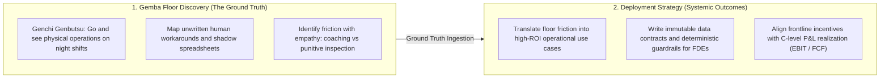

# Marcos Stipicich
### Supply Chain & Operations × Deployment Strategy

> *"In kind environments, where rules are fixed and feedback is immediate, machines win. In wicked environments—where patterns are messy, rules are unwritten, and human incentives collide—breadth with deep roots wins."*  
> — Adapted from David Epstein (*Range*) and frontline practice.

I operate at the intersection of physical operations, systems architecture, and unit economics.

---

## 🧠 The AI Era: From Knowledge Accumulation to Discernment

We have entered an era where the sheer accumulation of domain knowledge is commoditized. An AI model can summarize a textbook, retrieve an API, or synthesize a market report in seconds. 

In this landscape, competitive advantage is no longer about hoarding answers. It belongs to **range**:
1. **Knowing what questions to ask:** Framing the real, unstated problem rather than optimizing the wrong dashboard.
2. **Discernment & Judgment:** Recognizing weak signals, sniffing out bullshit metrics, and knowing precisely where a probabilistic model must *never* be allowed to make a decision.
3. **Cross-Domain Synthesis:** Connecting physical realities (the soil, the tools, worker psychology) to deterministic data contracts and the CFO's balance sheet.
4. **Radical Clarity:** True intelligence is not about hiding behind jargon or making things complicated. It is about understanding a system so deeply that you can bring simplicity, actionable contracts, and human adoption to what once seemed chaotic.

---

## 🌾 The Roots of Range: From the Sheep Ranch to Enterprise Systems

My range was not built in a classroom or behind a corporate desk:

* **Reading Weak Signals in the Field:** Raised on an extensive sheep ranch in remote southern territories, learning from childhood to read weak signals—shifting winds, pasture humidity, animal demeanor—to anticipate seasonal survival before reports existed. That same muscle allows me today to walk a warehouse at 02:00 AM and detect why a WMS or AI deployment is about to fail before management sees the metric drop.
* **Respect for the Floor (*Gemba*):** Sharing the table and the shearing sheds with frontline laborers taught me an unshakeable rule: *the operator on the floor holds practical truths that the executive manual ignores*. Real authority is earned by treating the operator as a peer, not by imposing top-down slideware.
* **Under the Hood (Curiosity & C):** Tearing apart old computers as a kid evolved into programming in C: the stubborn need to understand pointers, memory, and physical mechanics rather than trusting opaque abstractions.
* **Cross-Language, Cross-Silo Translation:** Learning English at 25 without translating taught me that language shapes how organizations think. Today, I translate seamlessly between three groups that rarely understand each other: the frontline floor worker, the software engineer, and the CFO.

---

## 🔄 Operating Methodology: Gemba Discovery Meets Deployment Strategy

A fundamental failure mode in enterprise AI is the gap between software builders and operational floor reality. Forward Deployed Engineers (FDEs) often design from conference rooms assuming clean data, while traditional Lean consultants lack the software architecture skills to govern AI systems.

I bridge this divide by uniting **frontline Gemba observation** (Toyota Production System, Kaizen, Genchi Genbutsu) with **end-to-end Deployment Strategy** (Palantir / Databricks model):

| Gemba Principle (Operational Method) | Deployment Strategist Role (Client Outcome) | Practical Supply Chain Translation |
| :--- | :--- | :--- |
| **Genchi Genbutsu** (*Go & see for yourself*) | Embed in the client's environment, observing real constraints. | Walk the docks, observe night picking, and inspect receiving discrepancies in person. |
| **Ask "What is really happening?"** | Technical & commercial discovery: bridge stated pain vs. root cause. | Discover that broken orders are manufactured by flawed volume bonuses, not "random error." |
| **Identify Waste (*Muda*) & Bottlenecks** | Quantify high-value use cases, risk, and dependencies. | Calculate carrying costs ($i_{\text{holding}}$), stockout rates, and blocked working capital. |
| **Work with Frontline Operators** | Align frontline teams to engineering, security, and C-level. | Replace top-down slideware with physical simulation and peer-to-peer adoption. |
| **Standardize & Improve (*Kaizen/PDCA*)** | Pilot tightly bounded MVPs, measure value, and exit hypercare. | Deploy deterministic decision gates and hand off operating protocols to client teams. |

### The Philosophy: The Art of Learning on the Floor
Drawing from Josh Waitzkin’s *The Art of Learning*, true operational mastery is not about accumulating superficial tricks or complicated jargon:
* **Making Smaller Circles:** Deconstructing the micro-mechanics of every physical movement and transaction until the root constraint becomes completely obvious.
* **The Soft Zone:** Maintaining clear judgment, presence, and calm focus amidst operational chaos, shift emergencies, and complex system cutovers.
* **Investment in Loss:** Dissecting operational failures forensically without defensiveness to build invariant guardrails that make the system unshakeable in production.

---

## 📄 Field Whitepaper: Dirty Data Is a Rational Answer

### [Dirty Data Is a Rational Answer](https://cdn.jsdelivr.net/gh/esstipi-debug/esstipi-debug@main/papers/dirty-data-is-a-rational-answer.pdf) *(29 pages · PDF)*
**The economics of broken records:** why WMS cutovers and AI break on the dock, and how to deploy with human incentives instead of against them.

> *"A better algorithm cannot fix a record that is distorted where it is written."*

In one retailer's audits, 65% of nearly 370,000 inventory records did not match the shelf. The paper's argument: accuracy costs the person typing the record time now, while the error costs someone else money later.

* **[📄 Read the PDF](https://cdn.jsdelivr.net/gh/esstipi-debug/esstipi-debug@main/papers/dirty-data-is-a-rational-answer.pdf)** · **[View in repository](papers/dirty-data-is-a-rational-answer.pdf)**
* **Core topics:** What breaks in a Tier-1 WMS cutover · The arithmetic of the shortcut (Becker, Kerr, Grudin) · Bainbridge's ironies of automation · A two-level architecture designed so the correct record becomes the fastest path · Where AI fits, and where it never writes.

---

## 📄 Field Bestiary: Nobody Pays for Being Wrong

### [Nobody Pays for Being Wrong](https://cdn.jsdelivr.net/gh/esstipi-debug/esstipi-debug@main/papers/nobody-pays-for-being-wrong.pdf) *(27 pages · PDF)*
**A bestiary of the go-live:** why obeying the system and dodging it answer the same rule, and what a rule looks like when nobody has to carry it.

> *"When a system is wrong after go-live, the cost usually lands in a generic account, weeks later, with nobody's name on it."*

A sequel to the first paper, cast with Nietzsche's camel, lion and child. The paper's argument: the supervisor who obeys the system against the evidence and the picker who ships a dented unit look like opposites, but both are cheap for the person doing them, and so is deploying a system and leaving before the nail bends. The studies point to one lever for both errors: make someone answer for the decision, and ask for the reason before the override.

* **[📄 Read the PDF](https://cdn.jsdelivr.net/gh/esstipi-debug/esstipi-debug@main/papers/nobody-pays-for-being-wrong.pdf)** · **[View in repository](papers/nobody-pays-for-being-wrong.pdf)**
* **Six entries:** the dragon (the rules) · the camel (obeys) · the lion (dodges) · the scribe (draws the floor from the record) · the smith (deploys and leaves) · the child (a rule nobody has to carry), plus a field guide to tell them apart.

---

## 🔎 Demo: Which Record Lies?

### [Which Record Lies?](demos/which-record-lies) *(Python · tests included)*
**When a customer says "not received" and the system says "delivered", which record is wrong?** A small triage on a public marketplace dataset (Olist, 95,824 delivered orders with a review): 57% of the "not received" claims were written before the delivery was recorded, so they were late orders, not suspect customers. The rest disagrees with the delivery record, and sellers explain little of it.

* **[Code, tests and README](demos/which-record-lies)** · The dataset is not redistributed; the README lists the files used and their licence (CC BY-NC-SA 4.0).
* **Limits, stated up front:** the Portuguese text filter is crude (a hand check found partial deliveries and wrong items among the conflicts), and the dataset has no carrier or warehouse data, so those checks are described but not run.

---

## ⚡ Core Operational Systems & Architecture

### 1. [Kern](https://github.com/esstipi-debug/kern) — Deterministic SCM Engine & Claude MCP Server
High-precision analytical engine and agentic orchestrator for enterprise supply chain operations, built natively for Anthropic's Model Context Protocol (MCP).
* **Anti-Hallucination Invariant:**
  $$\textbf{LLMs reason, interpret, and translate} \quad \longleftrightarrow \quad \textbf{Deterministic software computes, bounds, and gates}$$
* **Pure Functional Mathematics:** Closed-form inventory policies, reorder thresholds, and capacity bounds, with a suite of **9,689 automated tests**.
* **Safe-Staging Writebacks:** Zero direct mutations to systems of record. Staged diffs with 900s TTLs, HMAC cryptographic verification, and a Shopify inventory connector.

### 2. [Mellon & Ithildin](https://github.com/esstipi-debug/mellon) — Enterprise Deployment Framework
Field toolkit, Pokayoke state machine contracts (Pydantic v2), and econometric audit harnesses for physical operations. Includes an interactive client-side [Dojo Simulator](https://esstipi-debug.github.io/mellon).

### 3. NoSilo — Cross-Silo Decision Governance *(private repository)*
Control plane architecture designed to reconcile commercial silos and supply chain constraints, enforcing automated *Launch-Readiness Gates* between ad spending and real warehouse stock availability.

---

## 🌐 Breadth of Field Experience Across Industries

* **Agricultural & Cold-Chain Logistics:** Modeled Arrhenius/Q10 degradation kinetics and multi-custody handovers to attribute thermal damage and dynamically route export perishables under strict shelf-life feasibility.
* **Industrial Warehousing & Tier-1 Migrations:** Supervised floor operations through a 50,000-SKU Tier-1 WMS cutover (custom platform to Manhattan) at a global equipment manufacturer's parts distribution centre in Melbourne, from operator training through go-live and hypercare; order processing time fell 20% after cutover.
* **DTC, Wholesale & Retail P&L Management:** Owned the P&L of a USD 30M cross-border e-commerce portfolio through 300% year-on-year growth, freeing roughly USD 5M of working capital tied up in inventory.
* **Deterministic Software Boundaries:** Built the boundary between AI models and transactional systems (Odoo, Shopify, MercadoLibre, SAP Business One, Excel): every write is staged, approved and audited by deterministic code.

---

### 📬 Coordinates

* **Location:** Santiago, Chile (UTC−3/−4 · Full overlap with US Business Hours)
* **LinkedIn:** [linkedin.com/in/marcos-stipicich](https://www.linkedin.com/in/marcos-stipicich)
* **Code & Architecture:** [github.com/esstipi-debug](https://github.com/esstipi-debug)
