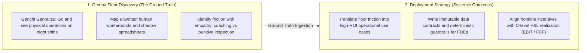

# Marcos Stipicich
### Deployment Strategist · Supply Chain & Operational Intelligence

> *"In kind environments, where rules are fixed and feedback is immediate, machines win. In wicked environments—where patterns are messy, rules are unwritten, and human incentives collide—breadth with deep roots wins."*  
> — Adapted from David Epstein (*Range*) and frontline practice.

I operate at the intersection of physical operations, systems architecture, and unit economics.

---

## 🧠 The AI Era: From Knowledge Accumulation to Discernment

We have entered an era where the sheer accumulation of domain knowledge is commoditized. An AI model can summarize a textbook, retrieve an API, or synthesize a market report in seconds. 

In this landscape, competitive advantage is no longer about hoarding answers. It belongs to **range**:
1. **Knowing what questions to ask:** Framing the real, unstated problem rather than optimizing the wrong dashboard.
2. **Discernment & Judgment:** Recognizing weak signals, sniffing out bullshit metrics, and knowing precisely where a probabilistic model must *never* be allowed to make a decision.
3. **Cross-Domain Synthesis:** Connecting physical realities (the soil, the tools, worker psychology) to deterministic data contracts and the CFO's balance sheet.
4. **Radical Clarity:** True intelligence is not about hiding behind jargon or making things complicated. It is about understanding a system so deeply that you can bring simplicity, actionable contracts, and human adoption to what once seemed chaotic.

---

## 🌾 The Roots of Range: From the Sheep Ranch to Enterprise Systems

My range was not built in a classroom or behind a corporate desk:

* **Reading Weak Signals in the Field:** Raised on an extensive sheep ranch in remote southern territories, learning from childhood to read weak signals—shifting winds, pasture humidity, animal demeanor—to anticipate seasonal survival before reports existed. That same muscle allows me today to walk a warehouse at 02:00 AM and detect why a WMS or AI deployment is about to fail before management sees the metric drop.
* **Respect for the Floor (*Gemba*):** Sharing the table and the shearing sheds with frontline laborers taught me an unshakeable rule: *the operator on the floor holds practical truths that the executive manual ignores*. Real authority is earned by treating the operator as a peer, not by imposing top-down slideware.
* **Under the Hood (Curiosity & C):** Tearing apart old computers as a kid evolved into programming in C: the stubborn need to understand pointers, memory, and physical mechanics rather than trusting opaque abstractions.
* **Cross-Language, Cross-Silo Translation:** Learning English at 25 without translating taught me that language shapes how organizations think. Today, I translate seamlessly between three groups that rarely understand each other: the frontline floor worker, the software engineer, and the CFO.

---

## 🔄 Operating Methodology: Gemba Discovery Meets Deployment Strategy

A fundamental failure mode in enterprise AI is the gap between software builders and operational floor reality. Forward Deployed Engineers (FDEs) often design from conference rooms assuming clean data, while traditional Lean consultants lack the software architecture skills to govern AI systems.

I bridge this divide by uniting **frontline Gemba observation** (Toyota Production System, Kaizen, Genchi Genbutsu) with **end-to-end Deployment Strategy** (Palantir / Databricks model):

| Gemba Principle (Operational Method) | Deployment Strategist Role (Client Outcome) | Practical Supply Chain Translation |
| :--- | :--- | :--- |
| **Genchi Genbutsu** (*Go & see for yourself*) | Embed in the client's environment, observing real constraints. | Walk the docks, observe night picking, and inspect receiving discrepancies in person. |
| **Ask "What is really happening?"** | Technical & commercial discovery: bridge stated pain vs. root cause. | Discover that broken orders are manufactured by flawed volume bonuses, not "random error." |
| **Identify Waste (*Muda*) & Bottlenecks** | Quantify high-value use cases, risk, and dependencies. | Calculate carrying costs ($i_{\text{holding}}$), stockout rates, and blocked working capital. |
| **Work with Frontline Operators** | Align frontline teams to engineering, security, and C-level. | Replace top-down slideware with physical simulation and peer-to-peer adoption. |
| **Standardize & Improve (*Kaizen/PDCA*)** | Pilot tightly bounded MVPs, measure value, and exit hypercare. | Deploy deterministic decision gates and hand off operating protocols to client teams. |

### The Philosophy: The Art of Learning on the Floor
Drawing from Josh Waitzkin’s *The Art of Learning*, true operational mastery is not about accumulating superficial tricks or complicated jargon:
* **Making Smaller Circles:** Deconstructing the micro-mechanics of every physical movement and transaction until the root constraint becomes completely obvious.
* **The Soft Zone:** Maintaining clear judgment, presence, and calm focus amidst operational chaos, shift emergencies, and complex system cutovers.
* **Investment in Loss:** Dissecting operational failures forensically without defensiveness to build invariant guardrails that make the system unshakeable in production.

---

## 📚 Master Monograph: The Deployment Chasm

### [The Deployment Chasm: Definitive Edition](https://github.com/esstipi-debug/mellon/releases/download/v2.0.0/THE-DEPLOYMENT-CHASM-EN-OFFICIAL.pdf) *(117-Page Master Monograph · Protected PDF)*
A comprehensive treatise on why enterprise systems, automation, and frontline AI initiatives collapse in operations—and how deterministic architecture bridges the gap.

* **[Executive Synopsis & Table of Contents](https://github.com/esstipi-debug/mellon/tree/master/papers)** · **[📥 Download Definitive Monograph (117 Pages · Protected PDF)](https://github.com/esstipi-debug/mellon/releases/download/v2.0.0/THE-DEPLOYMENT-CHASM-EN-OFFICIAL.pdf)**
* **Frontline Sociology & Campbell’s Law:** Deconstructing the root causes of operational boycotts and perverse incentives (e.g., volume bonuses subsidizing order defects).
* **The Three-Plane Architecture:** Strict separation between probabilistic LLM reasoning, deterministic invariant verification, and human operational authority.
* **Economic Transmission Engine:** Econometric modeling (Staggered DiD) translating floor-level bottleneck relief directly into working capital velocity, FCF realization, and EBITDA protection.

> **Executive Field Specification (24 Pages):**  
> For executive committees, CFOs, and engineering leads, the core mechanisms, proofs, and transition tables of the 117-page monograph are condensed into the [Field Architecture Paper](https://github.com/esstipi-debug/mellon/blob/master/papers/THE-DEPLOYMENT-CHASM-FIELD-ARCHITECTURE-PAPER-EN.pdf) (accompanied by the 8-minute [Executive Brief](https://github.com/esstipi-debug/mellon/blob/master/EXECUTIVE-BRIEF-DEPLOYED-STRATEGIST.md)).

---

## ⚡ Core Operational Systems & Architecture

### 1. [Kern](https://github.com/esstipi-debug/kern) — Deterministic SCM Engine & Claude MCP Server
High-precision analytical engine and agentic orchestrator for enterprise supply chain operations, built natively for Anthropic's Model Context Protocol (MCP).
* **Anti-Hallucination Invariant:**
  $$\textbf{LLMs reason, interpret, and translate} \quad \longleftrightarrow \quad \textbf{Deterministic software computes, bounds, and gates}$$
* **Pure Functional Mathematics:** Closed-form inventory policies, reorder thresholds, and capacity bounds backed by **9,100+ automated test cases**.
* **Safe-Staging Writebacks:** Zero direct mutations to systems of record. Staged diffs with 900s TTLs, HMAC cryptographic verification, and live Shopify inventory reconciliation.

### 2. [Mellon & Ithildin](https://github.com/esstipi-debug/mellon) — Enterprise Deployment Framework
Field toolkit, Pokayoke state machine contracts (Pydantic v2), and econometric audit harnesses for physical operations. Includes an interactive client-side [Dojo Simulator](https://esstipi-debug.github.io/mellon).

### 3. [NoSilo](https://github.com/esstipi-debug/nosilo) — Cross-Silo Decision Governance
Control plane architecture designed to reconcile commercial silos and supply chain constraints, enforcing automated *Launch-Readiness Gates* between ad spending and real warehouse stock availability.

---

## 🌐 Breadth of Field Experience Across Industries

* **Agricultural & Cold-Chain Logistics:** Modeled Arrhenius/Q10 degradation kinetics and multi-custody handovers to attribute thermal damage and dynamically route export perishables under strict shelf-life feasibility.
* **Industrial Warehousing & Tier-1 Migrations:** Led floor-level cutovers of major facilities (including a 50,000-SKU master distribution center for a tier-1 global equipment manufacturer in Melbourne migrated to Manhattan WMS), training unionized shift operators on live racks and cutting cycle times by 20% with zero plant downtime.
* **DTC, Wholesale & Retail P&L Management:** Managed multi-million-dollar consolidated commercial operations, liberating trapped working capital by synchronizing purchasing rules with physical throughput.
* **Healthcare Logistics & Waitlist Forensic Engineering:** Formulated logistics optimization models for surgical waitlists and hospital supply chains (the "last 50 meters" of clinical distribution).
* **Deterministic Software Boundaries:** Designed and verified the interface between probabilistic AI models and enterprise transactional databases across 5 distinct domains—enforcing business invariants through structural verification rather than fragile prompts.

---

### 📬 Coordinates

* **Location:** Santiago, Chile (UTC-3 · Full overlap with US Business Hours)
* **LinkedIn:** [linkedin.com/in/marcos-stipicich](https://www.linkedin.com/in/marcos-stipicich)
* **Code & Architecture:** [github.com/esstipi-debug](https://github.com/esstipi-debug)
