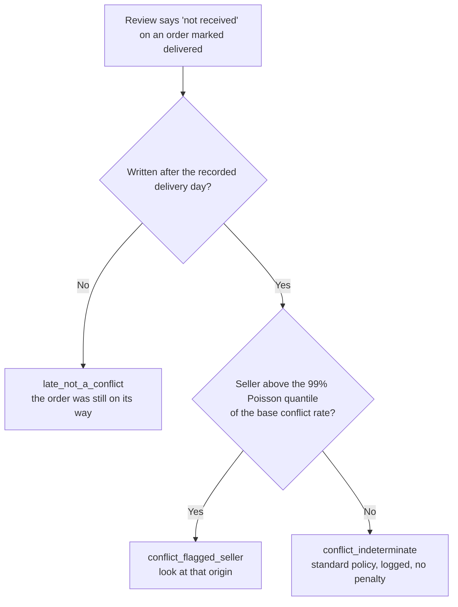

# Which record lies?

When a customer says "I never received it" and the system says "delivered", the records disagree. Before judging the customer, two questions come first:

1. **When did the customer write, relative to the recorded delivery?** A claim written before the delivery was recorded describes a late order, not a conflict.
2. **Does what is left concentrate at one origin** more than the base rate allows?

This demo runs both on a public marketplace dataset. It is a triage, not a verdict: "indeterminate" is a valid outcome.



## Result on a public marketplace

Olist, Brazil, 2016-2018. Run on 2026-11-03 with the three files listed under [Data](#data), default settings.

| | Orders | Share of claims |
|---|---:|---:|
| Delivered orders with a review | 95,824 | |
| ...with a review that says "not received" | 2,708 | 100% |
| `late_not_a_conflict`: written on or before the recorded delivery day | 1,542 | 56.9% |
| `conflict_flagged_seller`: written after, seller above the chance threshold | 73 | 2.7% |
| `conflict_indeterminate`: written after, nothing says where | 1,093 | 40.4% |

What it shows:

- **Most "not received" claims on delivered orders predate the recorded delivery.** 57% are late orders, not suspect customers. A rule that flags "delivered + not received" would have flagged all 1,542 for the wrong reason.
- **The rest, 1,166 orders (1.22%), is a conflict between records, but a crude one.** Hand check of random samples: of 40 conflict messages, 22 say the order did not arrive; 18 are partial deliveries (9), a wrong item or variant (4), an invoice or other matter (4) or a late delivery (1). Of 15 "late" messages, all 15 say the order had not arrived. After the recorded delivery, the free text mixes "nothing arrived" with "something did, but not all of it".
- **Sellers explain little.** 8 of 413 sellers with at least 50 orders sit above the 99% Poisson quantile of the base rate, against at most about 4 expected by chance. Together they hold 73 of the 1,166 conflicts (6.3%) with 2.0% of the orders. A small excess, not enough to blame any seller.

## How it works

1. Keep orders with status `delivered`, a delivery date and at least one review.
2. A review "says not received" if its title or message matches a Portuguese pattern (`NOT_RECEIVED_PATTERN`, accents stripped).
3. The customer's words are dated by `review_answer_timestamp` and compared, at day level, with `order_delivered_customer_date`. On or before the delivery day: late. After it: conflict.
4. Base conflict rate = conflicts / orders. For each seller with at least 50 orders, the threshold is the 99% Poisson quantile of `orders x base rate`. A seller above it is flagged. The seller is the one of the order's first item.
5. With many sellers, `alpha x sellers` flags are expected by chance alone; the script prints that bound next to the count.

## Run it

```bash
pip install -r requirements.txt
python which_record_lies.py path/to/olist
python -m pytest
```

Options: `--alpha 0.01` (flag level) and `--min-orders 50` (sellers with fewer orders are not assessed). Tested with Python 3.13; 68 tests on synthetic data, no Olist files needed.

## Data

Not included in this repository. Download the Brazilian E-Commerce Public Dataset by Olist from [Kaggle](https://www.kaggle.com/datasets/olistbr/brazilian-ecommerce) (licence CC BY-NC-SA 4.0: attribution, non-commercial, share alike) and point the script at the folder with these files. The numbers above come from:

| File | Rows | SHA-256 |
|---|---:|---|
| `olist_orders_dataset.csv` | 99,441 | `8df58ef3d2d7e9944010f7beecd9b75367f5588ec6e3c91cec19ae3345ef9ecf` |
| `olist_order_reviews_dataset.csv` | 99,224 | `012b61c7593e34f51fa614efdf802b9c7056ce6aae5307ddb93236e7cfc797d7` |
| `olist_order_items_dataset.csv` | 112,650 | `0bc4d068c4fe38cbb01bd90e8746e3c613fe7b4baef75fab7b0e329701c3e279` |

## Limits

- **The text filter is crude.** It cannot tell "nothing arrived" from a partial delivery, a wrong item or a message about an invoice (see the hand check above). Treat the conflict count as an upper bound for "delivered but never arrived". A reliable version needs a claim-type field (nothing arrived / partial / wrong item / damaged), not free text.
- **Which date.** `review_creation_date` is not used: in this data it looks like the day the survey went out (the day after the recorded delivery for 89% of reviews, and never later than the answer). Using it instead would label 44 of the 1,166 conflicts as late. The Kaggle page does not document the columns, so this is read from the data.
- **Day granularity.** A claim on the delivery day counts as late, not as a conflict.
- **Several sellers in one order.** The order is attributed to the seller of its first item.
- **A flagged seller is not a guilty seller.** Product mix and destinations differ, and the Poisson rule assumes the same base rate for everyone.
- **No carrier, route, driver, packing weight or GPS in this dataset.** The carrier and warehouse checks below cannot be tested here.
- **One marketplace, one period.** Nothing here says anything about another company.

## What a company's own data would add

| Record | Fields | Question |
|---|---|---|
| Warehouse | weight at packing closure vs master weight, with a tolerance | Did it leave the building complete? |
| Carrier | delivery scan, route, driver, GPS; claims per route vs its own baseline | Is the route above its normal rate? |
| Claim | type, date, evidence | Late order, partial delivery, empty box, wrong item? |
| Contract | liability limits, deadlines, proof required | What can be recovered, and how? |

## What this is not

- Not a customer score. No per-customer reputation is built or used.
- Not a fraud detector. It separates "late order" from "records disagree" and says where the disagreement concentrates; "indeterminate" means standard policy and no penalty.
- Not evidence about any company's operations.

## Licence

Code: MIT, see [LICENSE](LICENSE). Data: not included; Olist, *Brazilian E-Commerce Public Dataset by Olist*, Kaggle, CC BY-NC-SA 4.0.
